# Centrale inertielle MPU-6500 sur STM32F407

Pilote en C embarqué d'un capteur inertiel (accéléromètre + gyroscope 3 axes) sur microcontrôleur STM32, réalisé dans le cadre du **M1 Expert Systèmes Embarqués** (module de C embarqué).

*Embedded C driver for an MPU-6500 IMU on an STM32F407 (I2C, HAL, EXTI), with logic-analyzer validation of the I2C bus.*

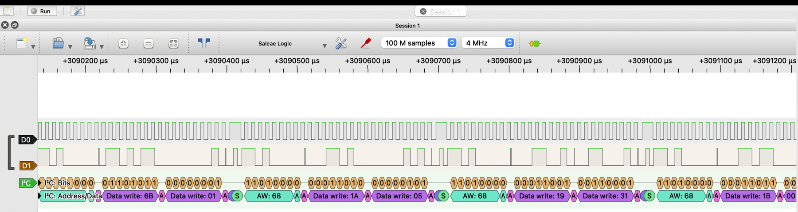

## Sommaire

- [Objectif](#objectif)
- [Matériel et outils](#matériel-et-outils)
- [Câblage](#câblage)
- [Architecture logicielle](#architecture-logicielle)
- [Configuration du capteur](#configuration-du-capteur)
- [Résultats et validation](#résultats-et-validation)
- [État d'avancement](#état-davancement)
- [Compiler et flasher](#compiler-et-flasher)
- [Ce que ce projet m'a appris](#ce-que-ce-projet-ma-appris)

## Objectif

Acquérir les mesures d'une centrale inertielle, les convertir en unités physiques, puis (étapes en cours) les envoyer à un PC par USB pour les tracer en Python et calculer l'orientation (roulis, tangage) affichée sur un écran OLED.

## Matériel et outils

| Élément | Détail |
|---|---|
| Carte | STM32F407G-DISC1 (Cortex-M4, 168 MHz, FPU) |
| Capteur | Module vendu comme MPU-6050 ; le registre WHO_AM_I renvoie `0x70`, soit un **MPU-6500** |
| Bus | I2C1 à 100 kHz, adressage 7 bits |
| Outils | STM32CubeMX, STM32CubeIDE 2.2 (HAL ST, débogage SWD par ST-LINK), PulseView + analyseur logique 8 voies |

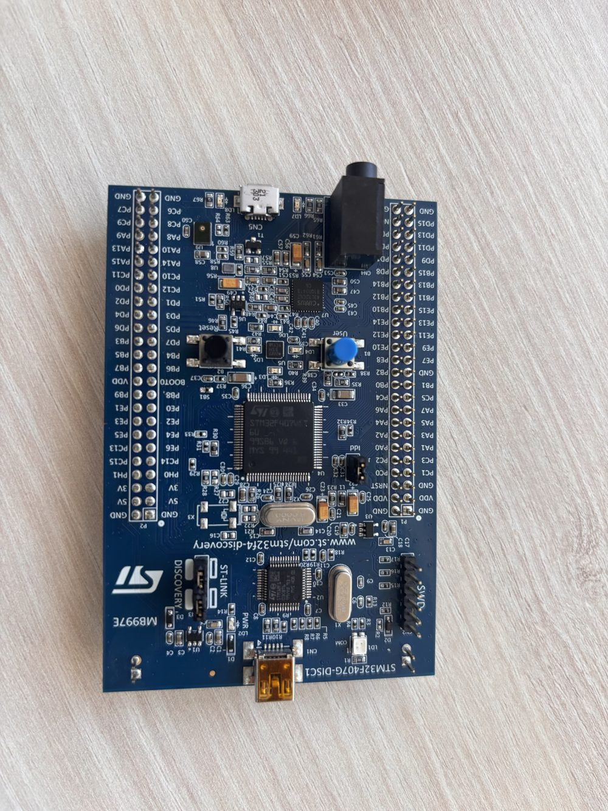

## Câblage

| Capteur | STM32F407 | Connecteur Discovery |
|---|---|---|
| VCC | 3V | P2 broche 5 |
| GND | GND | P2 broche 1 |
| SCL | PB6 (I2C1_SCL) | P2 broche 23 |
| SDA | PB7 (I2C1_SDA) | P2 broche 24 |
| INT | PC2 (EXTI2, front montant) | P1 broche 10 |
| AD0 | GND (adresse `0x68`) | – |

### Montage

<table>
<tr>
<td width="50%">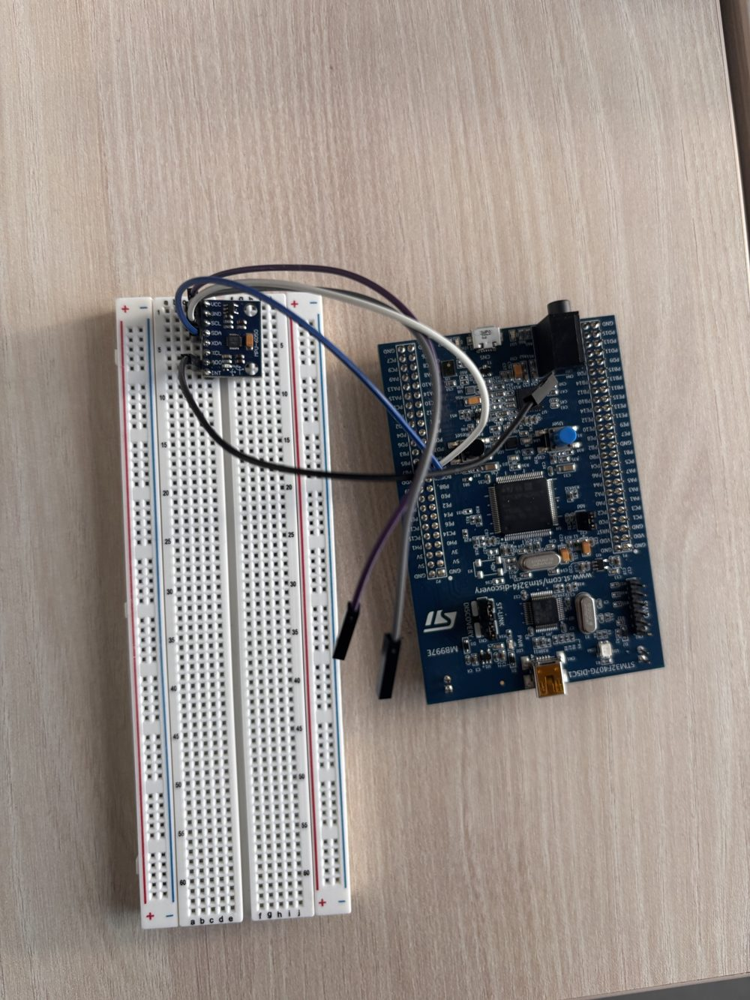</td>
<td width="50%">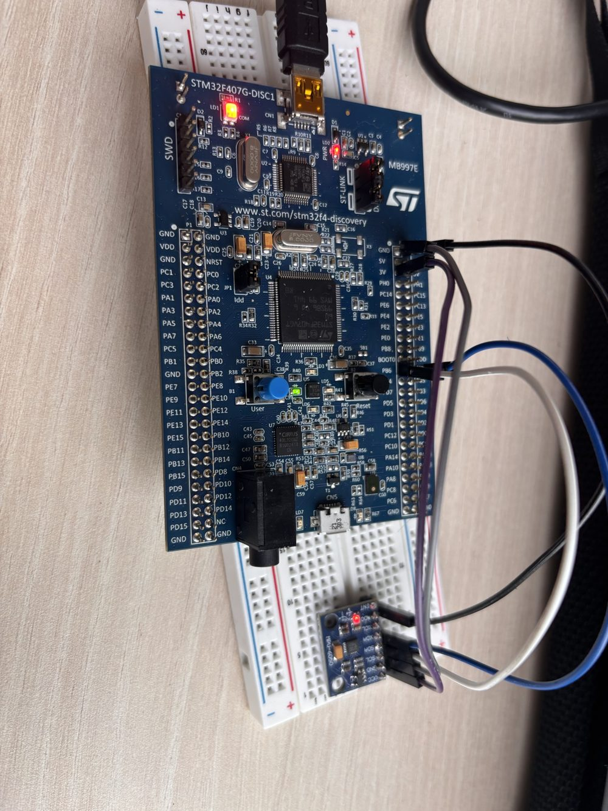</td>
</tr>
<tr>
<td>Câblage du module sur plaque d'essai (avant l'ajout du fil INT).</td>
<td>Capteur détecté : la LED verte LD4 bascule à chaque lecture réussie.</td>
</tr>
<tr>
<td>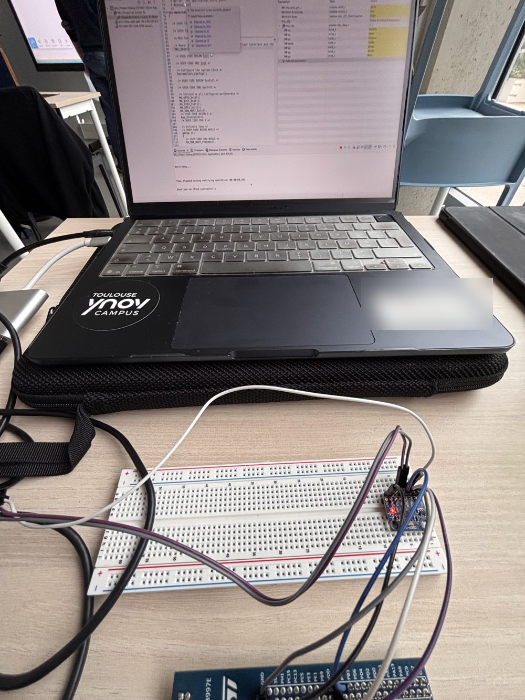</td>
<td>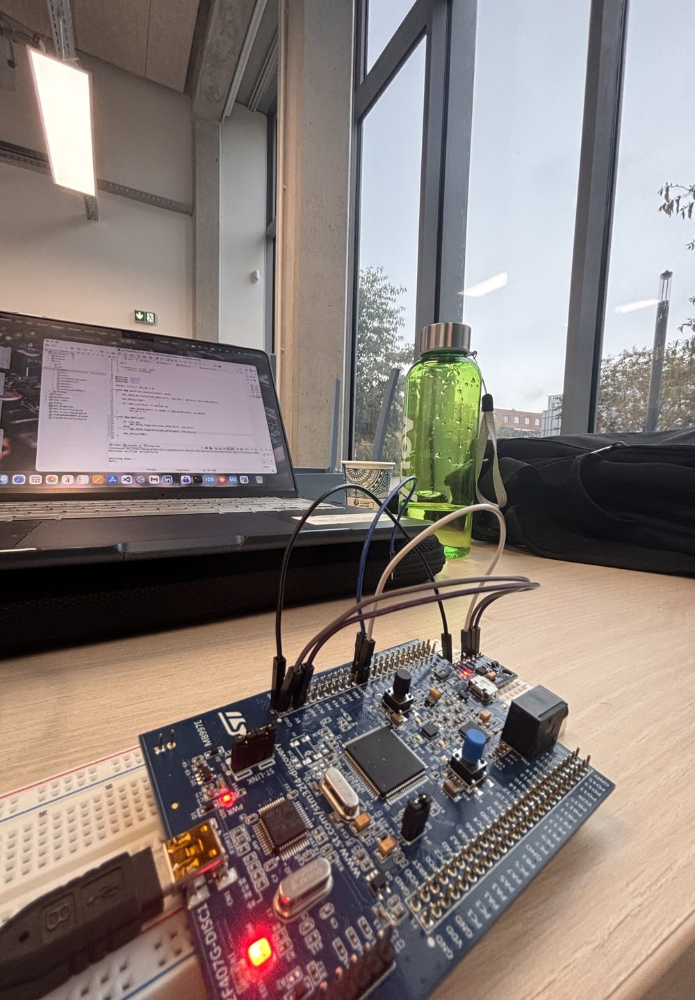</td>
</tr>
<tr>
<td>Session de débogage : programme flashé, mesures <code>imu_raw</code> suivies dans Live Expressions.</td>
<td>Poste de travail : STM32CubeIDE et la carte en cours de test.</td>
</tr>
</table>

## Architecture logicielle

Le code applicatif est séparé du code généré par CubeMX : `main.c` ne contient que deux appels, et les modules `app` et `imu` ne sont jamais régénérés.

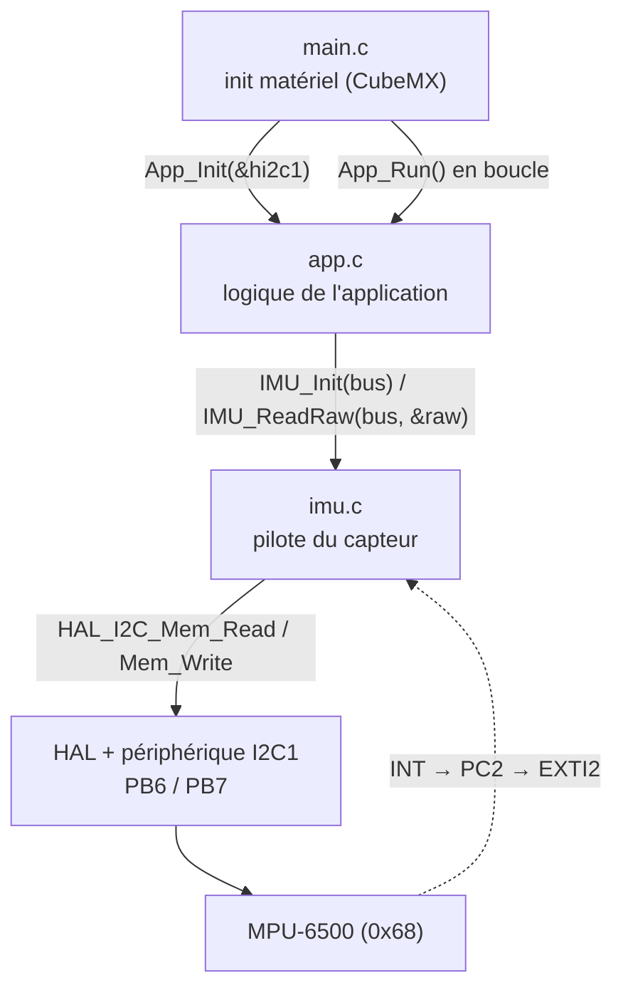

| Fichier | Rôle |
|---|---|
| [`Core/Src/imu.c`](firmware/IMU_Project/Core/Src/imu.c) | Pilote : identification, réveil, configuration, lecture en rafale des 14 octets de mesures |
| [`Core/Inc/imu.h`](firmware/IMU_Project/Core/Inc/imu.h) | Registres, facteurs de conversion, types `IMU_Raw_t` / `IMU_donne_t`, prototypes |
| [`Core/Src/app.c`](firmware/IMU_Project/Core/Src/app.c) | Application : détection du capteur, lecture périodique, conversion en g, °/s, °C, LEDs d'état |
| [`IMU_Project.ioc`](firmware/IMU_Project/IMU_Project.ioc) | Configuration CubeMX (broches, horloges, I2C1, EXTI2) |

Choix de conception :

- le bus I2C est **passé par pointeur** (`I2C_HandleTypeDef *bus`) au lieu d'être une variable globale `extern` : le pilote est réutilisable sur un autre bus ;
- chaque pointeur reçu est vérifié (`NULL`), chaque appel HAL a son **code de retour propagé** ;
- les variables internes du pilote sont `static` et lues par des accesseurs (`IMU_GetWhoAmI()`) ;
- les 7 mesures sont lues en **une seule transaction** de 14 octets (auto-incrément du capteur), donc toutes au même instant.

## Configuration du capteur

Valeurs déduites de la *Register Map* à partir du cahier des charges :

| Exigence | Registre | Valeur |
|---|---|---|
| Réveil, horloge PLL du gyroscope | `PWR_MGMT_1` (0x6B) | `0x01` |
| Filtre passe-bas ~10 Hz, gyroscope à 1 kHz | `CONFIG` (0x1A) | `0x05` |
| Échantillonnage 20 Hz : 1 kHz / (1 + 49) | `SMPLRT_DIV` (0x19) | `49` (`0x31`) |
| Gyroscope ±250 °/s (131 LSB par °/s) | `GYRO_CONFIG` (0x1B) | `0x00` |
| Accéléromètre ±2 g (16 384 LSB par g) | `ACCEL_CONFIG` (0x1C) | `0x00` |
| Impulsion sur INT à chaque nouvelle mesure | `INT_ENABLE` (0x38) | `0x01` |

Le filtre à ~10 Hz respecte la condition de Shannon pour un échantillonnage à 20 Hz.

## Résultats et validation

### Bus I2C à l'analyseur logique

La période de SCL mesurée entre deux curseurs vaut **10 µs, soit 100 kHz**, conforme à la configuration :

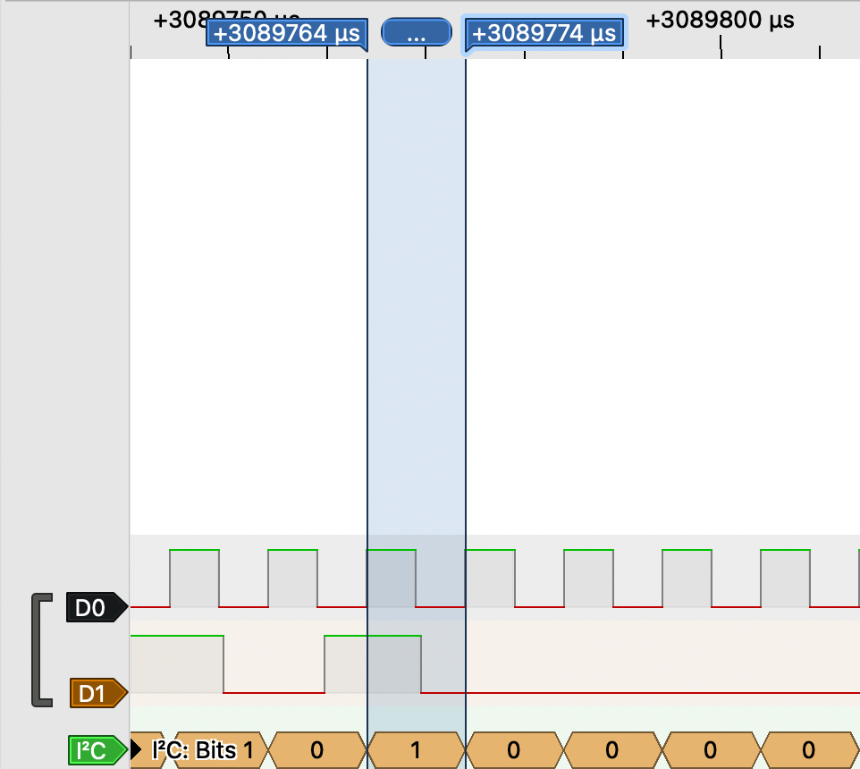

Les trames décodées correspondent exactement au code d'initialisation : `AW:68 → 6B → 01` (réveil), `1A → 05`, `19 → 31`, `1B → 00`, chaque octet acquitté (ACK) :

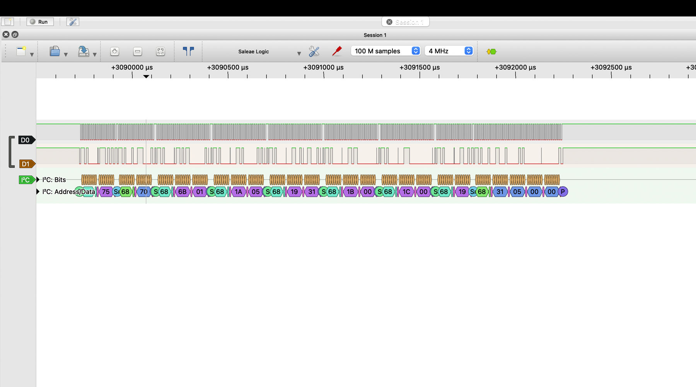

### Configuration vérifiée par relecture des registres

`WHO_AM_I = 0x70`, aucune erreur I2C, et les 4 registres relus contiennent bien `0x31, 0x05, 0x00, 0x00` :

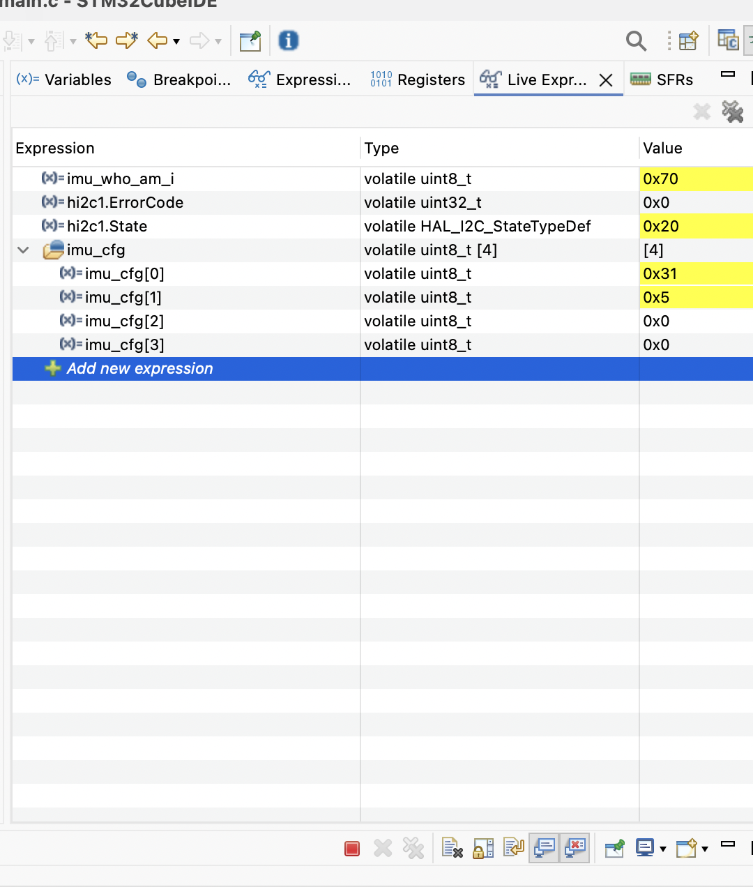

### Mesures brutes et converties

Capteur à plat : `az ≈ 15 976` brut, soit **0,975 g** (gravité), et un biais du gyroscope de quelques °/s, à calibrer.

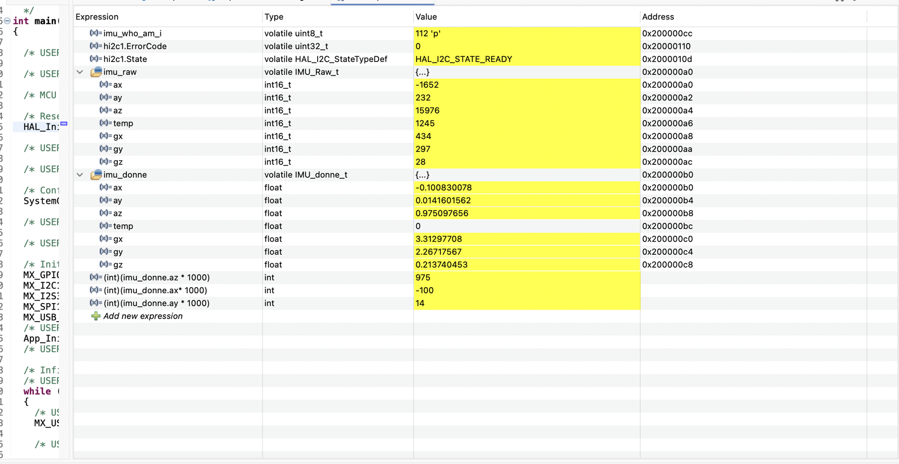

*La capture date d'avant l'ajout de la conversion de la température (d'où `temp = 0`), corrigée depuis.*

| Grandeur | Brut | Converti |
|---|---|---|
| Accélération Z | 15 976 | 0,975 g |
| Accélération X | −1 652 | −0,10 g |
| Vitesse angulaire X | 434 | 3,3 °/s (biais) |
| Température (MPU-6500 : brut / 333,87 + 21) | ≈ 1 200 | ≈ 24,6 °C |

## État d'avancement

- [x] Configuration CubeMX (horloges 168 MHz, I2C1 sur PB6/PB7, EXTI2 sur PC2)
- [x] Architecture modulaire `main` / `app` / `imu`
- [x] Identification du capteur (WHO_AM_I), réveil, configuration, vérification par relecture
- [x] Lecture des 14 octets de mesures et conversion en g, °/s, °C
- [x] Validation du bus I2C à l'analyseur logique
- [ ] Acquisition cadencée par l'interruption « donnée prête » (INT → EXTI2) *(en cours : activation côté capteur faite)*
- [ ] Envoi au PC par USB (classe CDC) et tracé temps réel en Python
- [ ] Calibration du gyroscope, angles par filtre complémentaire
- [ ] Affichage sur écran OLED SSD1306 (I2C)

## Compiler et flasher

1. Cloner le dépôt, puis dans STM32CubeIDE : **File → Import → Existing Projects into Workspace** et choisir `firmware/IMU_Project`.
2. **Project → Build** (0 erreur, 0 avertissement).
3. Brancher la carte (mini-USB, côté ST-LINK), puis **Run** ou **Debug**.
4. Dans *Live Expressions*, ajouter `imu_raw` et `imu_donne` pour suivre les mesures.

> Sur macOS Apple Silicon, le débogueur de CubeIDE peut afficher « No ST-LINK detected » si Rosetta 2 n'est pas installé (le composant `stlink-server` est compilé pour Intel). Solution : `softwareupdate --install-rosetta`.

## Ce que ce projet m'a appris

- Lire une datasheet et une *register map* pour traduire un cahier des charges en valeurs de registres.
- Le protocole I2C au niveau du signal : START / STOP, adresse + bit R/W, ACK / NACK, START répété, lecture en rafale.
- Structurer du C embarqué : modules, pointeurs, `static`, `volatile`, propagation des erreurs.
- Valider par la mesure (analyseur logique, relecture des registres, cohérence physique des valeurs) plutôt que supposer.
- Diagnostiquer une panne de chaîne d'outils par élimination méthodique des causes.

## Licence

Code applicatif (`app.c`, `app.h`, `imu.c`, `imu.h`) sous licence MIT. Les fichiers générés par STM32CubeMX et les pilotes HAL / CMSIS de STMicroelectronics conservent leurs licences d'origine (voir les en-têtes des fichiers).

---

Mostapha Kemacha · [LinkedIn](https://www.linkedin.com/in/mostapha-kemacha-347a36262)
